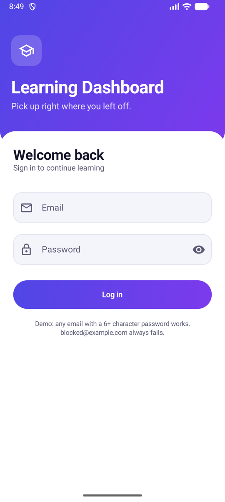
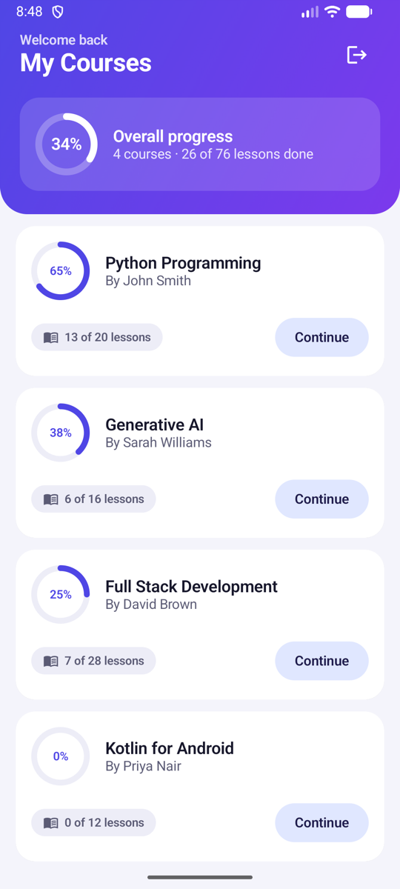
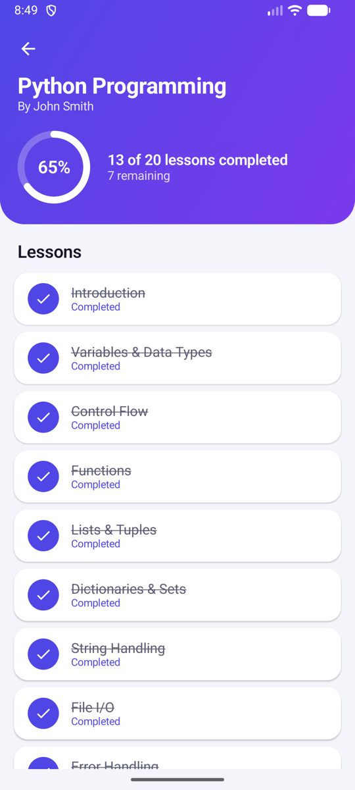
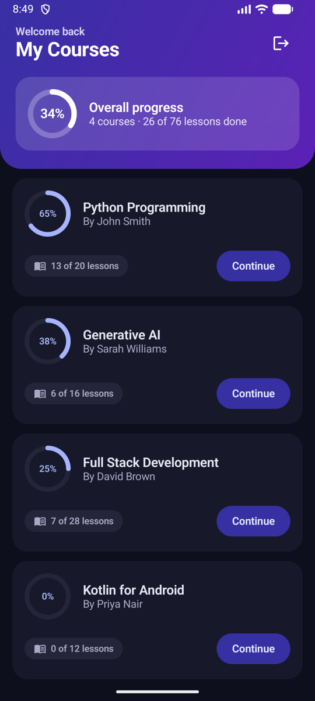

# Learning Dashboard

Android · Kotlin · Jetpack Compose · MVVM + Repository · Room · Retrofit

**[Download APK](https://github.com/kevalpanwala27/learning-dashboard/releases/latest)** · **[Watch the demo (2 min)](demo/demo.mp4)**

Login → course list → course details → mark lessons complete → works offline after the first load.
Demo login: any valid email with a 6+ character password. `blocked@example.com` always fails, to show the error state.

<p>
  
  
  
  
</p>

## Run it

```bash
# Release build fetches mock-api/courses.json from this repo over HTTPS.
./gradlew assembleRelease

# Debug build fetches from a local server so loading, failure and offline can be tested without touching GitHub.
cd mock-api && python3 -m http.server 8080 &
./gradlew installDebug

./gradlew test        # unit tests
```

## How it is built

```
ui/            Compose screens + ViewModels (sealed UiState in a StateFlow)
      ↓
domain/        Course, Lesson, ProgressCalculator, LoginValidator, repository interfaces
      ↓
data/          CourseRepositoryImpl, MockAuthRepository
      ↓                       ↓
data/remote    Retrofit       data/local  Room (courses, lessons) + EncryptedSharedPreferences (token)
```

Dependencies are wired by hand in `di/AppContainer.kt`.

## 1. Architecture

MVVM with a repository, split into `ui`, `domain` and `data` packages. The ViewModel exposes one sealed `UiState` per screen, so loading, empty, error and success cannot overlap and every state the UI can show is a type the compiler checks. The repository is the only class that knows there are two data sources. The domain layer has no Android imports, which is why the progress calculator and the repository are tested with plain JUnit and fakes, with no emulator or Robolectric.

Dependency injection is a hand-written container rather than Hilt. For three screens that keeps every dependency visible in one file and removes annotation processing from the build. Moving to Hilt later is mechanical because every class already takes its dependencies through the constructor.

## 2. Offline support

Room is the single source of truth. The UI never reads from the network. It observes a `Flow` from Room, and a refresh is a side job that writes into Room. If the refresh fails with an `IOException`, the repository reports `Offline`, the list keeps showing the cached rows, and a banner says so. If Room is empty and the device is offline, the screen shows an error with a retry button instead.

Progress is never stored. It is derived from lessons: `completed / total`. The server's `progress` field is only used to seed which lessons start as completed on the first load. On every later refresh the server owns titles and the catalogue, and the device owns completion, so a refresh can never undo what the user did. The two tests in `app/src/test` cover exactly these rules.

One detail worth knowing: the sample data has a 40 % course with 16 lessons. No whole number of lessons gives 40 %, so the app shows 38 % (6 of 16). That is a consequence of deriving progress rather than trusting a stored percentage, and it is the behaviour I would keep.

## 3. Security

The session token is stored in `EncryptedSharedPreferences`, encrypted with an AES-256 key that lives in the Android Keystore, so it never sits in plain text on disk and cannot be read by a backup or a rooted file browser. In production I would keep the same storage, add a short-lived access token with a refresh token, attach it through an OkHttp interceptor rather than passing it by hand, clear it on logout and on a 401, and never log it. Nothing secret is in the repo or in `BuildConfig`.

## 4. Scale: 1 million users, hundreds of courses

- **Paginate the catalogue** with cursor-based paging and `Paging 3` backed by Room, so the list never loads hundreds of rows at once.
- **Make refresh cheap** with `ETag` / `If-None-Match` and a `Cache-Control` header, so most refreshes are a 304 and cost no payload.
- **Queue writes** in a `pending_updates` table and sync them with WorkManager, with server versioning to resolve conflicts, instead of the local-only completion used here.
- **Split by feature** into Gradle modules with Hilt, so teams can own `login`, `catalogue` and `player` independently and builds stay fast.
- **Observe it**: crash reporting, structured logging with request IDs, and a few product metrics (refresh failure rate, time to first course) so regressions are seen before users report them.

## 5. The same app on iOS / macOS

The layering carries over one-to-one. Screens become SwiftUI views driven by an `@Observable` view model holding an enum-based state (`.loading`, `.empty`, `.error`, `.success`), which is the Swift equivalent of a sealed interface. The repository stays a protocol with a URLSession implementation and SwiftData (or Core Data) as the local store, observed with `@Query` or a `FetchedResultsController`, so the UI again reads only from the database. `async`/`await` replaces coroutines, `AsyncStream` replaces `Flow`, the token goes in the Keychain, and the progress calculator and repository tests move to XCTest unchanged in intent. With Swift Package Manager modules the same code targets macOS with a `NavigationSplitView` instead of a `NavigationStack`.
